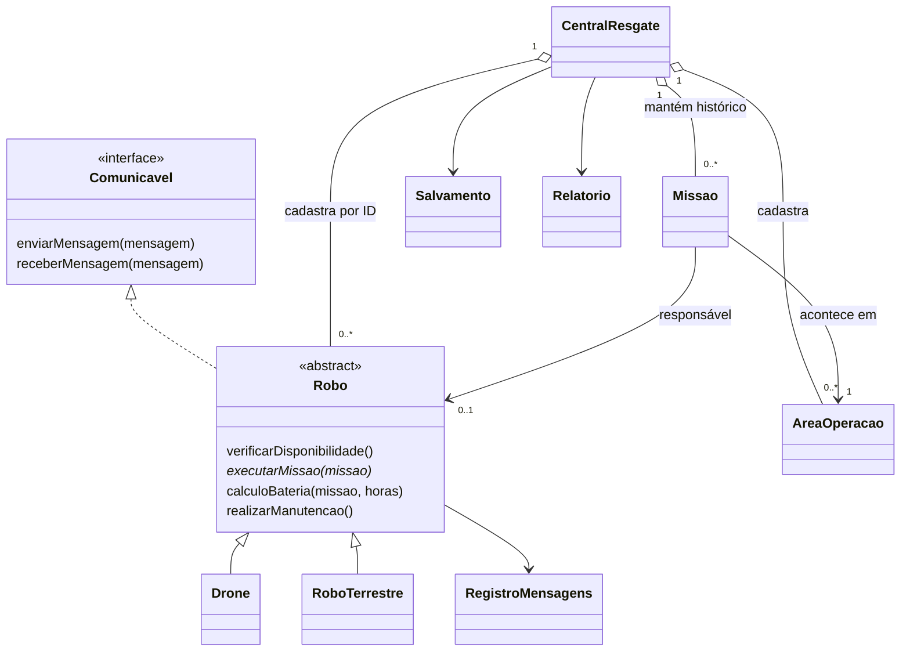
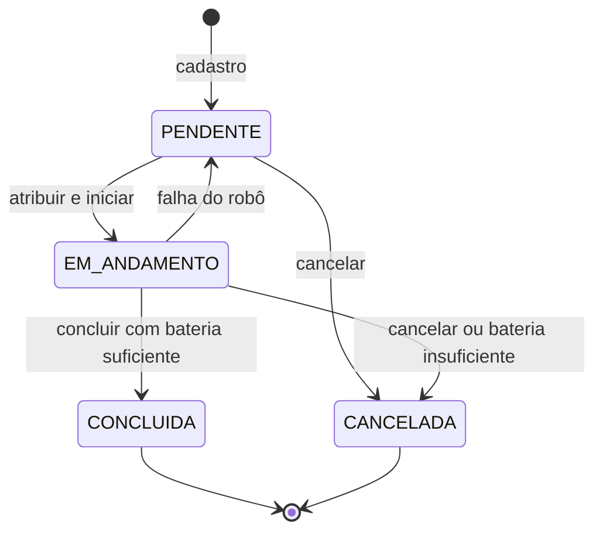

# Guia do código e da apresentação

Este guia descreve o código atual do projeto. Estude os fluxos e as decisões; não tente decorar cada linha. O objetivo da apresentação é conseguir explicar qual objeto cuida de cada responsabilidade e demonstrar as regras funcionando.

## 1. Como explicar o projeto em um minuto

> Nosso sistema simula uma central de resgate que coordena drones e robôs terrestres. A central cadastra áreas e missões e permite escolher um robô para realizar cada operação. Antes do início, o sistema verifica disponibilidade, bateria e compatibilidade com as condições da área. Durante o atendimento, a missão pode ser concluída, cancelada ou reatribuída após uma falha. Os robôs acumulam desgaste e podem precisar de manutenção preventiva. A central é salva em arquivo, as comunicações são registradas em texto e os relatórios mostram os resultados.

As regras de bateria e desgaste são regras da nossa simulação, escolhidas pelo grupo. Não são medições de robôs físicos.

## 2. Ordem recomendada para estudar

1. `src/Main/Main.java` e `src/Main/Menu.java`: entrada do programa e escolhas do usuário.
2. `src/Operacional/CentralResgate.java`: organização dos objetos e coordenação das operações.
3. `src/Operacional/Missao.java`: atribuição, início, conclusão, cancelamento e falha.
4. `src/Robos/Robo.java`: atributos comuns, disponibilidade, bateria, desgaste e manutenção.
5. `src/Robos/Drone.java` e `RoboTerrestre.java`: regras específicas.
6. `src/Area/AreaOperacao.java` e `src/Enum`: dados da área e categorias permitidas.
7. `src/Save/Salvamento.java`: persistência da central.
8. `src/Mensagens`: comunicação e registro em texto.
9. `src/Operacional/Relatorio.java`: resumos e arquivos de relatórios.
10. `tests/EncapsulamentoTest.java`, `ReatribuicaoMissaoTest.java` e `DesgasteTest.java`: exemplos das regras sendo verificadas.

## 3. Mapa das responsabilidades

| Classe ou pacote | O que faz | Exemplo de responsabilidade |
|---|---|---|
| `Main` | Inicia a aplicação | Cria o menu e chama `MenuStart()` |
| `Menu` | Apresenta opções e encaminha escolhas | A opção 8 chama a central para iniciar uma missão |
| `CentralResgate` | Mantém cadastros e coordena operações | Busca um robô pelo ID no mapa |
| `Missao` | Representa a atividade e controla seu ciclo | Passa de `PENDENTE` para `EM_ANDAMENTO` |
| `Robo` | Reúne dados e comportamentos comuns | Verifica disponibilidade e desconta bateria |
| `Drone` | Aplica regras do robô aéreo | Exige câmera termal à noite |
| `RoboTerrestre` | Aplica regras do robô de solo | Exige flutuação em área alagada |
| `AreaOperacao` | Guarda as condições do local | Terreno, risco, horário e altitude |
| `Comunicavel` | Define o contrato de comunicação | Exige envio e recebimento de mensagens |
| `ConversasRobos` | Alterna três diálogos predefinidos | Central pergunta e robô responde |
| `RegistroMensagens` | Acrescenta mensagens ao histórico | Grava data, remetente e destinatário |
| `Salvamento` | Grava e lê objetos e arquivos | Salva a central em `central.dat` |
| `Relatorio` | Gera resumos gerais e individuais | Conta missões por status |



O diagrama é um mapa de estudo das relações principais; não substitui um UML completo com todos os atributos para o relatório final.

## 4. O que acontece ao abrir o programa

`Main.main()` cria um `Menu` e chama `menu.MenuStart()`.

`Menu` mantém uma referência `static` à central. Quando a classe é inicializada, cria `CentralResgate`. O construtor prepara as coleções e chama `load()` para tentar recuperar `src/Saves/central.dat`.

- Se a leitura funciona, a instância atual recebe os dados recuperados.
- Se não existe arquivo, a aplicação continua com uma central nova.
- Se há erro de leitura, a aplicação mostra uma mensagem. Existe uma pendência de proteção do salvamento nesse caso; veja a seção de limitações.

`static` significa que o membro pertence à classe. As instâncias de `Menu` compartilham a mesma referência de central.

## 5. Como funciona o menu e o Scanner

`MenuStart()` sem parâmetro encaminha para `MenuStart(in)`. A versão que recebe o `Scanner` exibe as opções e lê a escolha:

```java
int opcao = in.nextInt();
in.nextLine();
Menu(opcao, in);
```

`nextInt()` lê o número, mas deixa a quebra de linha no fluxo. O `nextLine()` seguinte consome essa quebra, para o próximo cadastro não receber uma linha vazia.

Nos cadastros, os números são obtidos de linhas completas e convertidos. Alguns campos decimais aceitam vírgula e ponto por meio de `replace(',', '.')`.

Cada `case` realiza uma operação e chama `MenuStart(in)` novamente. Isso forma recursão indireta:

```text
MenuStart -> Menu -> operação na central -> MenuStart -> ...
```

Na opção 0, o programa salva a central e retorna, sem fazer outra chamada. Ao retornar, as chamadas anteriores também terminam; elas não executam novamente as operações já realizadas.

`InputMismatchException` trata uma escolha que não é um inteiro. O código consome a linha inválida antes de tentar novamente, evitando ler o mesmo texto indefinidamente. `NoSuchElementException` trata o fim da entrada.

**Limitação:** Java não elimina essas chamadas recursivas. Uma sessão extremamente longa pode esgotar a pilha. A recursão foi mantida por decisão do grupo; um laço seria mais adequado para execução contínua.

## 6. Por que usamos List, Map e Queue

| Estrutura | Campo da central | Motivo |
|---|---|---|
| `Map<String, Robo>` com `LinkedHashMap` | `robos` | Permite encontrar um robô diretamente pelo ID e mantém a ordem de inserção |
| `List<AreaOperacao>` | `areas` | Mantém as áreas cadastradas para consulta |
| `List<Missao>` | `missoes` | Mantém as missões, inclusive concluídas e canceladas |
| `Queue<Missao>` com `LinkedList` | `missoesPendentes` | Representa missões aguardando atendimento |

Exemplo de busca no mapa:

```java
Robo robo = robos.get(idRobo);
```

A chave é o ID, como `R001`. O nome, como `drone01`, é outro atributo. Alterar o nome não muda a chave.

A central rejeita IDs repetidos e bloqueia alterações no ID depois do cadastro.

Os getters de mapa e listas retornam visões não modificáveis. A fila é entregue como cópia filtrada, sem expor a fila interna. Assim, quem consulta não consegue incluir ou remover registros internos por esses getters. Os setters de coleções fazem cópias e verificam consistência.

Isso não torna cada objeto imutável. As mudanças permitidas continuam disponíveis por métodos específicos, como atualizar o risco da área.

A opção de iniciar usa a primeira missão pendente da fila, na ordem de entrada. `peek()` consulta essa missão e `poll()` a remove somente após o início bem-sucedido. O usuário escolhe apenas o robô. O atributo de prioridade é registrado e exibido; não altera a ordem da fila.

## 7. Cadastro de áreas, robôs e missões

### Área

O cadastro lê ID, nome, localização, horário, terreno, risco, altitude e descrição. Os dados são lidos primeiro em variáveis locais. Somente depois de todos os campos serem convertidos e validados eles são atribuídos ao objeto.

Se um enum ou número for inválido, uma exceção interrompe o cadastro. A central captura o erro e não adiciona uma área parcial. `cadastrarArea()` também verifica ID único e condições obrigatórias.

### Robô

A central pergunta se o usuário quer um drone ou um terrestre. A subclasse chama `super.cadastraRobo(in)` para ler os dados comuns e depois lê as próprias características.

`cadastrarRobo()` valida o ID e inclui o objeto no mapa. O ID fica bloqueado para preservar a correspondência entre chave e objeto.

### Missão

É necessário existir uma área cadastrada. A missão recebe ID, descrição, tipo, prioridade e uma referência à área escolhida. O custo fixo de bateria é determinado pelo risco. O cadastro inicial é `PENDENTE`.

A central valida as referências e o ID antes de adicionar a missão ao histórico e à fila.

## 8. Atribuir, validar, iniciar e concluir são ações diferentes

Esta é uma das partes mais importantes da apresentação.

| Método | Papel |
|---|---|
| `Robo.executarMissao(missao)` | Método abstrato sobrescrito nas subclasses. Aplica as restrições específicas; não conclui a missão |
| `Robo.executaMissao(missao)` | Nome anterior mantido como encaminhamento para `executarMissao()` |
| `Missao.atribuirRobo(robo)` | Valida compatibilidade e bateria e associa o responsável |
| `Missao.iniciar()` | Inicia uma missão já atribuída e registra os estados e a data |
| `Missao.executar(robo)` | Conveniência que atribui e inicia, tratando erros |
| `CentralResgate.atribuirRoboMissao(idMissao, idRobo)` | Localiza os objetos cadastrados e encaminha a atribuição |
| `CentralResgate.executarMissao(scanner)` | Conduz a seleção pelo menu, inicia e atualiza a fila |
| `Missao.concluir()` | Calcula os efeitos da operação e encerra com sucesso ou falta de bateria |

Exemplo de uso dos métodos separados:

```java
central.atribuirRoboMissao("M001", "R001");
// Depois de obter a referência da missão:
missao.iniciar();
// Em outro momento:
missao.concluir();
```

Não tente fazer isso alterando `status` diretamente. Os métodos de ciclo preservam as regras que o setter isolado não conseguiria representar.

### Caminho ao escolher a opção 8

1. A central consulta a primeira missão da fila com `peek()` e mostra seu resumo e os robôs disponíveis.
2. O usuário informa apenas o ID do robô.
3. A central mantém a missão do topo e faz uma busca direta do robô no mapa.
4. A missão verifica se está pendente e se o robô pode atuar.
5. A subclasse verifica suas restrições.
6. O custo fixo é comparado à bateria disponível.
7. O responsável é atribuído.
8. `iniciar()` valida novamente e `iniciarOperacao()` vincula o robô à missão.
9. A missão fica `EM_ANDAMENTO`, o robô fica `EM_MISSAO` e `dataInicio` recebe o momento atual.
10. São registradas mensagens e uma conversa predefinida.
11. A central retira a primeira missão com `poll()`. Se o início falhar, ela permanece na frente da fila e nenhuma outra é iniciada.

As validações são repetidas no início porque a disponibilidade pode ter mudado depois da atribuição. Atribuir não reserva o robô para sempre; outro início pode torná-lo ocupado.

Não existe uma thread de simulação rodando em segundo plano. A missão permanece em andamento até uma ação de conclusão, cancelamento ou falha.

## 9. Restrições de cada tipo de robô

### Restrições comuns

A missão deve estar pendente, ter os dados necessários e não possuir outro responsável incompatível com a atribuição. O robô precisa estar disponível, ter bateria positiva e não exigir manutenção preventiva.

`verificarDisponibilidade()` reúne status, bateria, desgaste e ausência de outra operação vinculada. O campo `missaoAtual` impede liberar ou recarregar um robô por fora enquanto ele opera.

### Drone

- Pode fazer reconhecimento e localização de pessoas.
- Não pode transportar suprimentos.
- À noite precisa de câmera termal, representada por `thermal`.
- As altitudes precisam ser finitas e não negativas.
- A altitude da área não pode ultrapassar `altitudeMaxima + 50`, tolerância definida na simulação.

Exemplo: com altitude máxima 200, uma área de 250 passa por essa regra; 251 é rejeitada.

### Robô terrestre

- Atua apenas de dia.
- Em terreno `ALAGADO`, precisa de flutuação. O atributo está escrito `bouyancy` no código.
- Em terreno `IRREGULAR`, precisa de roda `OFFROAD`.
- Para transporte, a capacidade de carga precisa ser finita e positiva.

O código atual permite os três tipos de missão no terrestre, desde que as demais condições sejam atendidas. Ainda não há peso de suprimentos na missão, portanto não é feita comparação entre peso solicitado e capacidade de carga.

## 10. Estados e encerramento



### Concluir

`concluir()` exige missão em andamento, responsável e data de início. Calcula o tempo e o consumo.

- Com bateria suficiente: desconta a energia, acumula desgaste, marca `CONCLUIDA`, registra resultado e incrementa o contador do robô.
- Se o consumo ultrapassar a bateria: zera a energia, acumula desgaste, marca `CANCELADA` e registra o motivo. Não conta como missão concluída.

O robô encerra o vínculo com a operação. A decisão de status dá prioridade à manutenção por desgaste; caso contrário, ele fica `SEM_BATERIA` ou `DISPONIVEL`.

Se o consumo for exatamente igual à bateria, a missão pode terminar concluída, mas o robô fica sem bateria, salvo se o desgaste exigir manutenção.

### Cancelar

Uma missão pendente pode ser cancelada sem cobrar bateria ou desgaste de execução. Se ela estiver em andamento, o consumo acumulado e o desgaste são registrados e o robô é liberado conforme suas condições.

Missões concluídas ou canceladas não podem ser iniciadas outra vez. Os setters protegidos também impedem reabrir uma missão encerrada.

## 11. Cálculo da bateria, com exemplos

O consumo é medido em pontos percentuais de bateria.

| Risco | Custo fixo |
|---|---:|
| `BAIXO` | 10 |
| `MEDIO` | 25 |
| `ALTO` | 50 |

O tempo usa minutos completos:

```text
horas = minutos completos / 60.0
```

Por decisão do grupo, uma missão de 30 segundos cobra somente o custo fixo. Uma de 61 segundos considera um minuto de consumo variável.

**Terrestre:**

```text
consumo = custo fixo + consumo por hora × horas
```

Exemplo: risco baixo, taxa de 12 por hora e duração de 30 minutos:

```text
10 + 12 × 0,5 = 16 pontos de bateria
```

**Drone:**

```text
consumo = custo fixo + (taxa do robô + taxa da câmera, se equipada)
                       × horas × multiplicador de altitude
```

O multiplicador dobra a cada faixa completa de 200 m. O código soma o consumo da câmera sempre que `thermal` é verdadeiro, inclusive de dia.

| Altitude | Multiplicador |
|---|---:|
| 0 a menos de 200 m | 1 |
| 200 a menos de 400 m | 2 |
| 400 a menos de 600 m | 4 |
| A partir de 6.000 m | limitado a 2³⁰ |

Exemplo: risco médio, taxa do drone 6, câmera 2, duração de 30 minutos e altitude 200 m:

```text
25 + (6 + 2) × 0,5 × 2 = 33 pontos de bateria
```

O teto `2³⁰` impede o estouro que ocorreria na próxima multiplicação de um `int`. O teto do cálculo não permite voar acima do alcance do drone: a verificação de altitude máxima continua separada.

`descontarBateria()` arredonda o consumo para cima. Um consumo de 2,1 desconta 3 pontos. O valor da bateria permanece entre 0 e 100.

A energia não é descontada continuamente enquanto o usuário olha o menu. Ela é calculada ao concluir, cancelar em andamento ou registrar falha. Para iniciar, o código verifica o custo fixo; não conhece antecipadamente a duração final da operação.

## 12. Inovação: desgaste e manutenção preventiva

O desgaste vai de 0 a 100. Ele aumenta quando uma participação iniciada termina por conclusão, cancelamento ou falha.

| Condição | Acréscimo |
|---|---:|
| Base por participação | 10 |
| Risco médio | +5 |
| Risco alto | +10 |
| Drone com câmera termal | +5 |
| Drone em altitude a partir de 200 m | +5 |
| Terrestre em terreno irregular | +10 |
| Terrestre em terreno alagado | +5 |

Os valores se somam. Um drone com câmera termal, em área de risco alto e altitude 200 m, acumula 30 pontos: `10 + 10 + 5 + 5`.

A partir de 80 pontos, novas missões são bloqueadas e o robô entra em manutenção. O desgaste satura em 100.

- `calcularDesgaste()` determina o acréscimo; as subclasses acrescentam suas condições.
- `registrarDesgaste()` acumula o valor e pode marcar manutenção ao atingir o limite.
- `atualizarStatusAposOperacao()` encerra o vínculo com a missão e define o estado final.
- `realizarManutencao()` zera o desgaste, preserva a bateria e libera o robô se houver energia.

Recarga e manutenção são operações diferentes. Recarregar aumenta a bateria; manutenção recupera a condição do equipamento. Um robô não pode receber manutenção durante uma missão.

O desgaste é calculado ao terminar a participação, não a cada segundo. Um robô pode chegar ao limite ao concluir a missão e só então ficar impedido de assumir outra.

## 13. Extra avançada: reatribuição por falha

Na opção 13, o usuário informa o ID do robô com falha.

1. A central procura uma missão em andamento cujo responsável seja esse robô.
2. `interromperPorFalha()` desconta o consumo da participação e registra desgaste.
3. O robô fica `EM_MANUTENCAO`.
4. A missão volta para `PENDENTE`; o responsável e a data de início são retirados.
5. A central tenta os outros robôs na ordem do mapa.
6. O primeiro disponível que passe nas restrições e tenha bateria para o custo fixo assume a missão.
7. Sem substituto, a missão permanece pendente na fila.

O novo responsável inicia outra participação, com nova data. O robô antigo não recebe crédito de missão concluída. A participação do substituto terá seu próprio consumo fixo e variável.

A seleção é pelo primeiro candidato compatível, não pelo menor consumo ou pela maior bateria. A falha é registrada manualmente pelo usuário; não existe geração aleatória de falhas nem monitoramento de hardware.

## 14. Comunicação e relatórios

### Comunicação

`Comunicavel` exige `enviarMensagem(String)` e `receberMensagem(String)`. A implementação comum está em `Robo`; as subclasses mantêm sobrescritas que chamam `super`.

- Enviar: robô para central.
- Receber: central para robô.
- `RegistroMensagens` acrescenta cada registro a `src/Mensagens/mensagens.txt`, com data, hora e identificação.
- O arquivo usa acrescentamento, sem apagar as mensagens anteriores.

`ConversasRobos` possui uma matriz de três conversas. O índice avança por `(indice + 1) % 3`. Dentro de uma conversa, posições pares são falas da central e ímpares são respostas do robô.

As conversas são automáticas e predefinidas, sem inteligência artificial ou rede. Elas aparecem ao iniciar e ao usar a opção 12. O índice é `static`, compartilhado na execução, e reinicia quando o programa é aberto novamente.

### Relatórios

`Relatorio(CentralResgate)` conta os dados atuais: total de robôs, total de missões, concluídas e pendentes. A contagem usa os status das missões, não presume que o tamanho da fila seja sempre a quantidade correta.

Há sobrecarga de métodos: `gerarResumo()` e `salvarEmArquivo()` têm versões sem parâmetro, para uma missão e para uma lista de missões.

| Opção | Arquivo gerado |
|---|---|
| 17: geral | `src/Saves/relatorio_central.txt` |
| 18: uma missão | `src/Saves/relatorio_missao_ID.txt` |
| 19: todas | `src/Saves/relatorios_missoes.txt` |

Esses arquivos são salvos ao gerar o relatório, sem esperar a opção 0. Gerar novamente atualiza o arquivo correspondente. O ID é tratado para não criar caminhos de arquivo arbitrários.

## 15. Persistência: o que significa salvar objetos

A central é gravada em `src/Saves/central.dat` por `ObjectOutputStream`. A leitura usa `ObjectInputStream`.

As classes envolvidas implementam `Serializable`. Essa interface marca que seus objetos podem participar da serialização. Ela não exige a implementação de métodos.

O arquivo inclui o grafo de objetos: coleções, robôs, áreas e missões com seus relacionamentos. Ao ler, uma missão e o mapa da central continuam apontando para o mesmo robô recuperado, em vez de cópias independentes dele.

`serialVersionUID` identifica a versão serializada da classe. Manter um número explícito evita mudanças automáticas por alterações de métodos, mas não torna toda mudança de estrutura compatível.

`CentralResgate.readObject()` foi personalizado para:

- Ler robôs tanto de arquivos antigos com `List` quanto de arquivos atuais com `Map`.
- Reconstruir o mapa pelo ID.
- Restaurar bloqueios de identificação e cadastro.
- Restaurar o vínculo de robôs em missões em andamento.
- Reconstruir a fila das missões pendentes.

`readObject` é chamado pelo mecanismo de serialização, embora seja privado. Não é chamado manualmente pelo menu.

Ao abrir um arquivo antigo que não tinha desgaste, esse atributo começa em zero.

O carregamento normal atual usa `central.dat`. O antigo `areas.dat` não é importado automaticamente a cada inicialização. As áreas de demonstração já foram incorporadas à central anteriormente.

Os caminhos são relativos à pasta em que o programa é executado. Para a demonstração, use a raiz do projeto como diretório de trabalho.

## 16. Onde os conceitos de POO aparecem

| Conceito | Exemplo concreto | Como explicar |
|---|---|---|
| Encapsulamento | Campos privados, IDs bloqueados e coleções protegidas | Consultar um objeto não dá permissão para alterar livremente seus dados |
| Herança | `Drone extends Robo` e `RoboTerrestre extends Robo` | As subclasses reaproveitam dados e comportamentos comuns |
| Classe abstrata | `Robo` | Define o modelo comum; não criamos `new Robo()` |
| Método abstrato | `executarMissao(Missao)` | Obriga cada subclasse a definir as próprias restrições |
| Polimorfismo | Uma variável `Robo` pode guardar um drone ou terrestre | A implementação executada depende do objeto real |
| Interface | `Comunicavel` | Define o contrato de envio e recebimento |
| Sobrescrita | `@Override` em `calcularDesgaste()` e `executarMissao()` | A subclasse especializa um comportamento herdado |
| Sobrecarga | `gerarResumo()` com parâmetros diferentes | O mesmo nome atende entradas diferentes |
| Associação | Missão referencia área e responsável | Um objeto conhece outro necessário à operação |
| Enums | `StatusRobo`, `TipoMissao`, `NivelRisco` | Restringem valores a categorias conhecidas |
| Exceções | Entrada inválida lança erro antes de mudar o estado | Impedem que a operação prossiga com dados inadequados |

Exemplo de polimorfismo:

```java
Robo candidato = robos.get(id);
candidato.executarMissao(missao);
```

A variável é do tipo `Robo`, mas o objeto pode ser `Drone`. Nesse caso, as restrições de `Drone` são usadas. O mesmo ocorre com o cálculo de desgaste e, no drone, o cálculo de bateria.

`super` acessa a implementação da superclasse. O cadastro do drone usa o cadastro comum; o cálculo de desgaste específico aproveita o valor base de `Robo`.

`@Override` não cria a herança. A anotação ajuda o compilador a conferir que o método realmente sobrescreve outro.

`private` limita acesso à própria classe; `protected` permite especialização pelas subclasses; `public` expõe operações. Ser público não significa ser livre de validação.

## 17. Streams e lambdas sem decorar a sintaxe

Exemplo de consulta:

```java
robos.values().stream()
    .filter(Robo::verificarDisponibilidade)
    .toList();
```

- `values()` obtém os robôs do mapa.
- `stream()` cria uma sequência para processar os elementos.
- `filter()` mantém somente quem atende à condição.
- `Robo::verificarDisponibilidade` é uma referência de método; equivale a `r -> r.verificarDisponibilidade()`.
- `toList()` reúne os elementos filtrados.

`anyMatch()` pergunta se existe pelo menos um elemento que passa na condição. `noneMatch()` pergunta se não existe nenhum. `count()` conta. `findFirst().orElse(null)` encontra o primeiro resultado ou devolve `null`.

Essas operações não alteram automaticamente as coleções originais. A mudança só ocorre onde há uma ação explícita sobre os objetos ou coleções.

## 18. Roteiro de demonstração

Antes de apresentar, faça uma cópia do `central.dat` fora da pasta usada pela demonstração. Demonstrações alteram bateria, desgaste, status e histórico. Confira os IDs que realmente aparecem nas listagens.

### Fluxo principal

1. Abrir o programa e mostrar a confirmação de carregamento.
2. Consultar robôs, áreas e missões pelas opções 3, 4 e 2.
3. Mostrar apenas disponíveis pela opção 15.
4. Iniciar a primeira missão da fila pela opção 8, informando o ID de um robô compatível.
5. Mostrar a missão em andamento pela opção 16.
6. Conversar pela opção 12 e abrir o histórico de mensagens.
7. Concluir pela opção 9 e mostrar bateria, desgaste, contador e resultado.
8. Gerar relatório geral pela opção 17 e mostrar o arquivo.
9. Sair pela opção 0, reabrir e comprovar persistência.

### Uma tentativa inválida

Com uma missão de transporte no início da fila, tentar usar um drone. Explicar que a restrição impede o início e preserva os estados e a ordem da fila. Outra possibilidade é uma missão noturna com drone sem câmera termal no início da fila.

### Reatribuição

Iniciar uma missão com substituto compatível disponível. Registrar a falha pela opção 13, usando o ID do robô original. Mostrar o antigo em manutenção e o novo responsável. Se não houver substituto, mostrar a missão pendente.

### Desgaste em poucas operações

Para evitar oito ciclos durante a apresentação:

- Usar uma base de demonstração sem outras missões pendentes à frente das três que serão criadas.
- Criar uma área de risco `ALTO`, altitude 200 m, horário `DIA`, terreno `URBANO`.
- Usar um drone com câmera termal e altitude máxima de pelo menos 200 m.
- Criar três missões de reconhecimento nessa área.
- Concluir cada uma e recarregar entre as operações quando o robô estiver disponível.
- Cada participação gera 30 pontos de desgaste. Depois da terceira, o desgaste chega a 90 e o robô fica em manutenção.
- Usar a opção 20 e mostrar desgaste zero e a mesma bateria de antes da manutenção.

Se as missões forem encerradas em menos de um minuto, cada uma cobrará o custo fixo de 50 por ser risco alto. Por isso, não esqueça a recarga entre elas.

## 19. Perguntas que podem aparecer

**Por que `Robo` é abstrata?** Porque reúne o que os tipos têm em comum, mas cada tipo precisa de regras próprias. Não queremos um robô genérico sem especialização.

**Por que usar interface se já existe herança?** A herança compartilha implementação e estado. A interface explicita um contrato de comportamento que outras classes também poderiam implementar.

**Onde está o polimorfismo?** Nas chamadas pelo tipo `Robo` que executam validações e cálculos da subclasse real.

**Qual a diferença entre sobrescrita e sobrecarga?** Sobrescrita especializa um método herdado com a mesma assinatura. Sobrecarga usa o mesmo nome com parâmetros diferentes.

**Por que Map para os robôs?** O ID é uma chave natural. A busca é direta e o cadastro pode verificar repetição antes de inserir.

**Por que bloquear alteração do ID?** Se o objeto mudasse de ID e a chave antiga ficasse no mapa, uma busca pelo novo ID falharia.

**Por que getters de coleções são protegidos?** Para impedir inclusão ou remoção sem passar pelas regras da central.

**Getters protegidos tornam os objetos imutáveis?** Não. As coleções ficam protegidas estruturalmente, e os objetos continuam oferecendo operações validadas.

**Quando a bateria é descontada?** Ao concluir, cancelar em andamento ou registrar falha. O início apenas verifica o custo necessário para começar.

**O que acontece quando não há substituto?** O robô original fica em manutenção e a missão retorna à fila de pendentes.

**Quem escolhe o melhor substituto?** Atualmente não existe pontuação de melhor robô. A central utiliza o primeiro compatível disponível na ordem do mapa.

**Manutenção recarrega bateria?** Não. Zera desgaste; a recarga é uma operação separada.

**O que é `serialVersionUID`?** Um identificador usado para compatibilidade de classes serializadas. Não se deve trocá-lo sem pensar nos arquivos existentes.

**O arquivo texto substitui o `.dat`?** Não. O `.dat` guarda objetos para recuperar o sistema. Os `.txt` são históricos e relatórios legíveis.

**A fila escolhe a próxima missão sozinha?** Sim. A opção 8 apresenta a primeira pendente e pede somente o robô. A missão só sai da fila após iniciar com sucesso.

**O que a recursão faz aqui?** Mostra novamente o menu por chamadas entre `Menu` e `MenuStart`, até a opção 0 interromper as chamadas.

**O que é `NaN`?** Um valor de ponto flutuante que representa um resultado que não é um número. Não é válido para nossos consumos ou altitudes.

**Por que validar de novo ao iniciar?** Porque ter passado na atribuição não garante que o robô continue disponível quando a operação realmente começar.

**Quantos testes existem?** A última execução completa registrou 526 verificações aprovadas. Isso é cobertura de casos definidos, não uma prova de ausência de qualquer defeito.

**A IA foi usada?** Sim. O grupo deve descrever o apoio recebido e explicar o código incorporado. Uma sugestão recusada ou modificada pode ser relatada, como a troca de laço por recursão ou a retirada da limpeza de tela, explicando a decisão e seus efeitos.

## 20. Como executar e explicar os testes

Na raiz do projeto, com o JDK no PATH:

```powershell
powershell -ExecutionPolicy Bypass -File tests/ExecutarTestes.ps1
```

O script compila a aplicação e as classes de testes. Cada suíte executa em uma pasta própria dentro de `tmp`, para não gravar sobre a central ou as mensagens reais. Alguns testes usam cópias dos dados de demonstração. O script verifica os hashes dos arquivos protegidos ao final.

- `EncapsulamentoTest`: tenta alterar estados e coleções pelas APIs e verifica as proteções.
- `ExecucaoMissaoTest` e `RoboTerrestreTest`: validam compatibilidade e estados.
- `BateriaTest`: verifica fórmulas, arredondamento, duração e limite de altitude.
- `MapRobosTest`: verifica busca por ID e leitura de dados antigos.
- `DesgasteTest`: verifica desgaste, bloqueio e manutenção.
- `ReatribuicaoMissaoTest`: verifica troca de responsável e ausência de substituto.
- Testes de menu: verificam leitura, retorno ao menu e seleção por ID.
- Testes de relatórios e comunicação: conferem texto, arquivos e direção das mensagens.

`TestFixtures` pertence somente aos testes. Ele usa reflexão para preparar estados antigos ou propositalmente inválidos e testar a defesa dos métodos. Isso não é uma alternativa utilizada pela aplicação para contornar o encapsulamento.

## 21. Limitações que você deve saber explicar

- A proteção contra sobrescrever o arquivo depois de uma falha de carregamento ainda precisa ser implementada. Não salve por cima do arquivo original se aparecer erro de leitura.
- O salvamento atual grava diretamente no destino; ainda não utiliza troca por arquivo temporário e backup automático a cada gravação.
- A recursão do menu pode esgotar a pilha em sessões muito longas.
- A simulação não movimenta robôs reais, não acessa mapas nem realiza busca física por pessoas.
- Missões abaixo de um minuto não têm consumo variável, por regra escolhida.
- O início verifica o custo fixo, sem prever a duração completa; falta de bateria no encerramento pode cancelar a missão.
- A prioridade não organiza automaticamente a fila.
- A capacidade de carga é validada como positiva, mas ainda não é comparada a um peso solicitado.
- Algumas mensagens de erro são genéricas e há nomes antigos mantidos por compatibilidade.

Conhecer uma limitação é melhor do que prometer um comportamento que o programa não implementa.

## 22. Revisão rápida antes de apresentar

Você deve conseguir, sem olhar o guia:

- Desenhar `CentralResgate -> Missao -> AreaOperacao/Robo`.
- Explicar por que `Robo` é abstrata e apontar uma sobrescrita.
- Diferenciar `executarMissao`, `atribuirRobo`, `iniciar` e `concluir`.
- Fazer um cálculo simples de bateria e de desgaste.
- Justificar `List`, `Map` e `Queue`.
- Explicar por que o ID não muda depois do cadastro.
- Demonstrar uma operação válida e uma rejeitada.
- Mostrar o arquivo de mensagens e um relatório.
- Salvar, reiniciar e recuperar os dados.
- Explicar a inovação de manutenção preventiva e a reatribuição como extra avançada.

Uma sequência de estudo útil é: leia uma seção, feche o guia, explique em voz alta e depois encontre o método correspondente no código.
