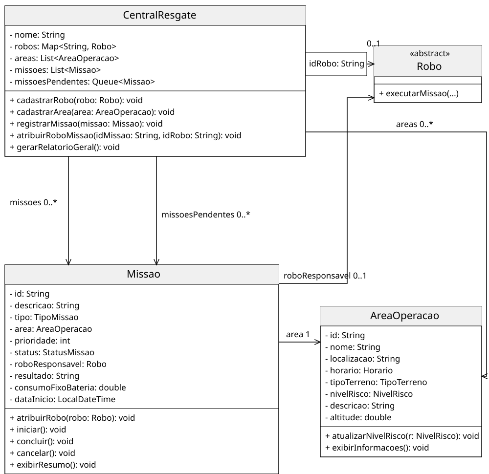
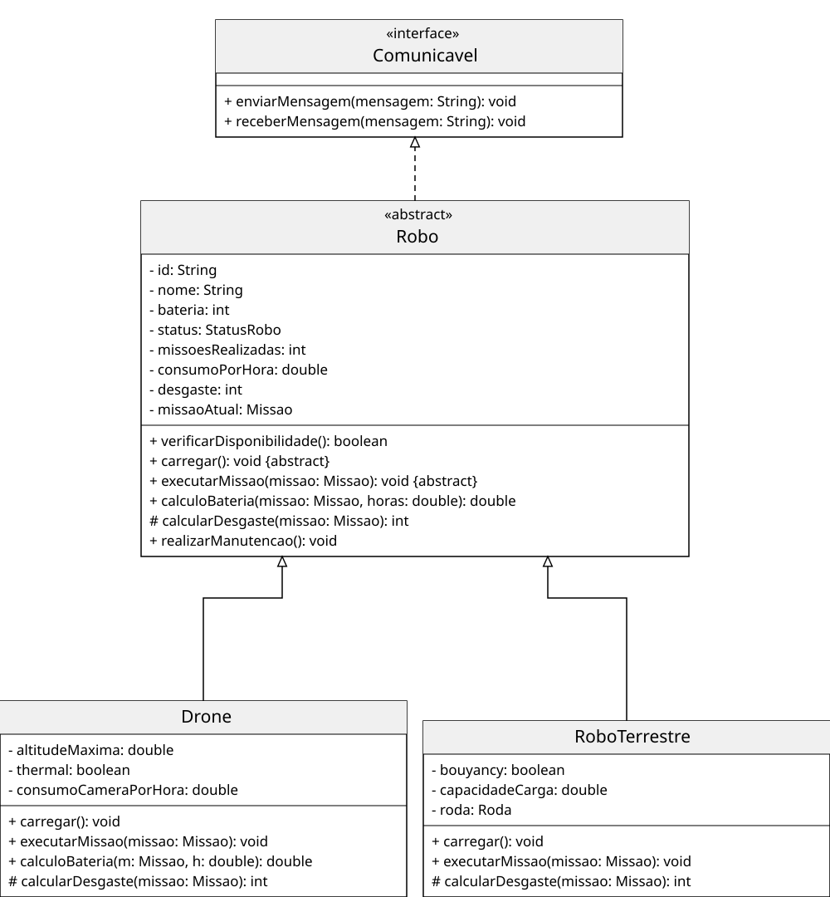
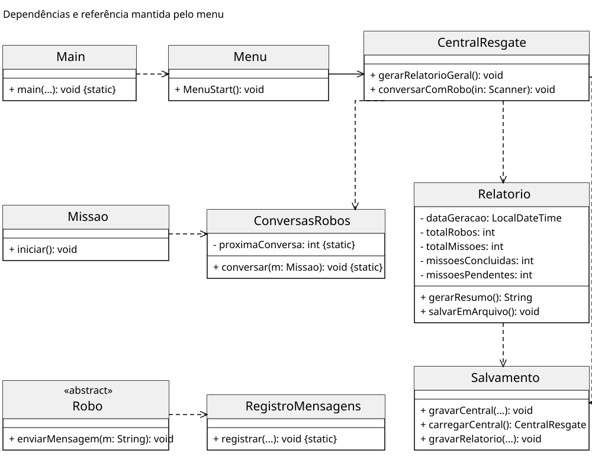
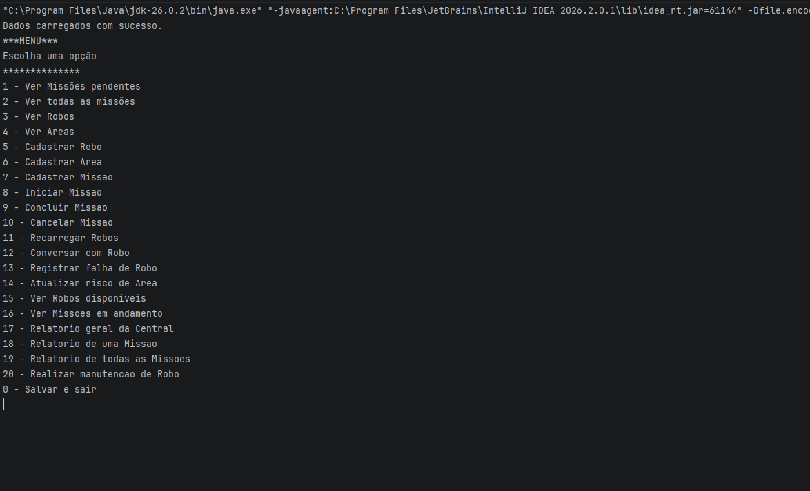
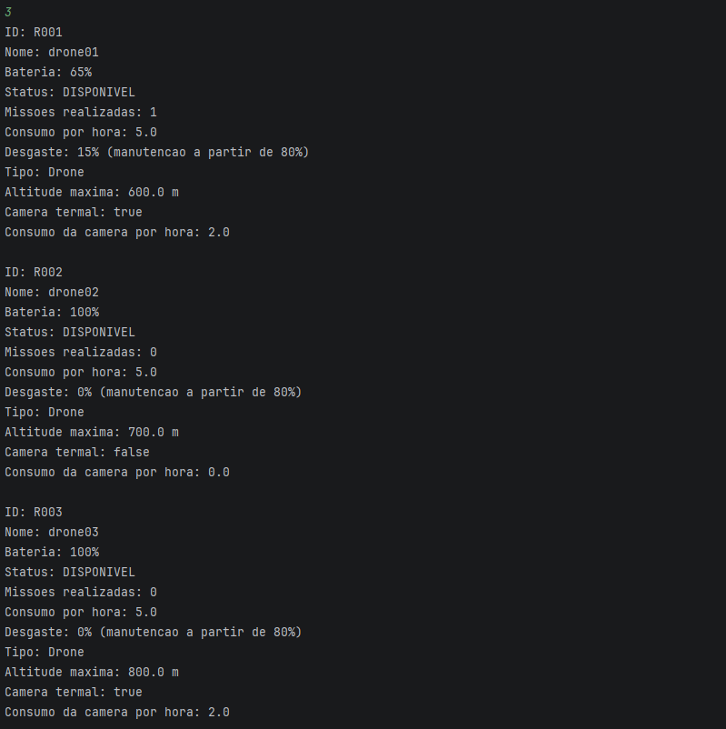
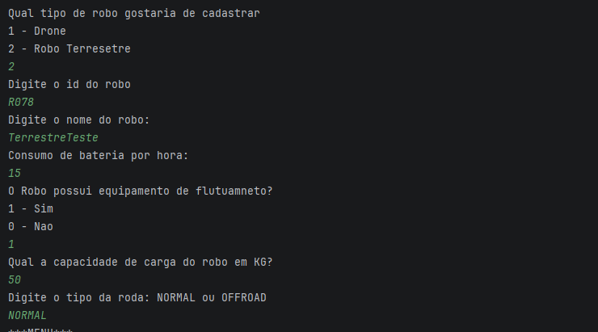
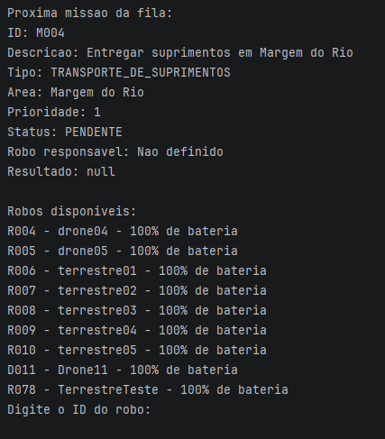
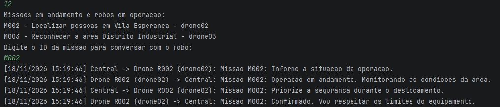

# Sistema de coordenação de robôs para missões de resgate

Relatório final de Programação Orientada a Objetos

Trabalho final 2026/02

Caua Souza · Lucas Neves · Lucas Gargioni

Novembro de 2026

<!-- pagebreak -->

## 1 Apresentação do sistema

Desenvolvemos uma aplicação Java de console para coordenar drones e robôs terrestres em missões simuladas de resgate. O sistema permite cadastrar áreas, robôs e missões, selecionar um responsável compatível, acompanhar operações e consultar seus resultados. Os dados da central são salvos em arquivo para continuar o trabalho em outra execução.

As missões são classificadas em reconhecimento, localização de pessoas e transporte de suprimentos. As condições da área, como horário, terreno, risco e altitude, influenciam a escolha do robô e os efeitos da operação. A simulação também registra mensagens entre a central e os robôs e gera relatórios em texto.

Acrescentamos o desgaste com manutenção preventiva como funcionalidade inovadora. Também implementamos a reatribuição de uma missão quando o usuário registra uma falha do robô responsável, uma das funcionalidades avançadas sugeridas no enunciado.

### Organização e fluxo de execução

`Main` inicia a aplicação, e `Menu` recebe as escolhas do usuário. `CentralResgate` mantém os cadastros e coordena as operações. `Missao` controla atribuição, início e encerramento; `Robo` e suas subclasses cuidam das condições e dos efeitos relacionados ao equipamento. `AreaOperacao` descreve o local em que a missão acontece.

O fluxo de início consulta a missão do topo da fila e solicita apenas o ID do robô. Depois de localizar o equipamento, valida disponibilidade, compatibilidade e bateria, atribui o responsável e chama `iniciar()`. Nesse momento, a missão fica `EM_ANDAMENTO`, o robô fica `EM_MISSAO` e a data de início é registrada. A central retira a missão da fila somente após esse início bem-sucedido.

O método abstrato `executarMissao(Missao)` aplica as restrições de cada tipo de robô. A mudança de estado ocorre no ciclo da missão, por meio de `atribuirRobo()` e `iniciar()`. O método `Missao.executar(Robo)` reúne essas duas etapas. Essa distinção evita interpretar uma validação bem-sucedida como conclusão da operação.

Ao concluir, o programa calcula o tempo decorrido e atualiza bateria, desgaste, resultado e estados. Se a energia for suficiente, a missão fica `CONCLUIDA` e o contador do robô aumenta. Se o consumo superar a bateria, ela é zerada e a missão fica `CANCELADA`. Também é possível cancelar uma missão por escolha do usuário. Missões encerradas não podem ser iniciadas novamente.

O menu retorna às opções por chamadas recursivas entre `MenuStart()` e `Menu()`. Na leitura da opção, `nextInt()` é seguido de `nextLine()` para consumir a quebra de linha. Entradas incompatíveis são tratadas antes de uma nova tentativa.

<!-- pagebreak -->

## 2 Modelagem UML

Os diagramas apresentam as principais classes, atributos, métodos e relacionamentos do código. Getters, setters, construtores e alguns métodos auxiliares foram omitidos para manter a leitura. Os sinais `-`, `#` e `+` representam acesso privado, protegido e público.

### 2.1 Central áreas e missões



As coleções pertencem à central. Cada missão cadastrada referencia uma área e pode ter um robô responsável. A referência `roboResponsavel` pode continuar no histórico após a conclusão. Já `Robo.missaoAtual` representa somente uma operação ativa e é liberada no encerramento. Por isso, são relações distintas.

Na associação com os robôs, o qualificador `idRobo: String` representa a chave de `Map<String, Robo>`. Uma chave identifica no máximo um robô. A quantidade de valores guardados no mapa pode variar de zero a vários.

<!-- pagebreak -->

### 2.2 Robôs e comunicação



`Robo` é abstrata e implementa `Comunicavel`. As subclasses especializam a validação da missão, o cadastro, a exibição e o cálculo de desgaste. `Drone` também sobrescreve o cálculo de bateria. A linha contínua com triângulo vazio representa herança; a tracejada com triângulo vazio representa realização da interface.

Utilizamos sete enumerações: `StatusRobo`, `StatusMissao`, `NivelRisco`, `TipoTerreno`, `TipoMissao`, `Horario` e `Roda`. Seus valores são apresentados na seção seguinte. Esses tipos restringem os estados e as categorias aceitos pela aplicação.

<!-- pagebreak -->

### 2.3 Classes auxiliares e enumerações



As setas tracejadas com ponta aberta representam dependências. Por exemplo, a central cria um `Relatorio` para gerar um resumo, e `Relatorio` utiliza `Salvamento` para gravá-lo. Isso não exige que a central mantenha o relatório como atributo.

`RegistroMensagens` acrescenta os registros ao histórico. `ConversasRobos` organiza três diálogos predefinidos e alterna entre eles. As dependências mostram as chamadas feitas por `Missao`, `CentralResgate` e `Robo`. As classes de enumeração são usadas como tipos dos atributos indicados nos outros diagramas.

| Enumeração | Valores |
|---|---|
| `StatusRobo` | `DISPONIVEL`, `EM_MISSAO`, `EM_MANUTENCAO`, `SEM_BATERIA` |
| `StatusMissao` | `PENDENTE`, `EM_ANDAMENTO`, `CONCLUIDA`, `CANCELADA` |
| `NivelRisco` | `BAIXO`, `MEDIO`, `ALTO` |
| `TipoTerreno` | `URBANO`, `ALAGADO`, `IRREGULAR` |
| `TipoMissao` | `RECONHECIMENTO`, `LOCALIZACAO_DE_PESSOAS`, `TRANSPORTE_DE_SUPRIMENTOS` |
| `Horario` | `DIA`, `NOITE` |
| `Roda` | `NORMAL`, `OFFROAD` |

<!-- pagebreak -->

## 3 Coleções utilizadas

Escolhemos as coleções de acordo com a forma de consulta e atualização dos dados.

| Campo na central | Implementação e justificativa |
|---|---|
| `robos: Map<String, Robo>` | `LinkedHashMap` permite localizar um robô pelo ID e preserva a ordem de inserção. Essa ordem também orienta a procura de substitutos após uma falha. |
| `areas: List<AreaOperacao>` | `ArrayList` mantém as áreas disponíveis para listagem e seleção. A busca por ID percorre a coleção. |
| `missoes: List<Missao>` | `ArrayList` preserva o histórico, incluindo missões pendentes, em andamento e encerradas. Os relatórios consultam essa lista. |
| `missoesPendentes: Queue<Missao>` | `LinkedList` representa as missões aguardando atendimento. O cadastro inclui a missão, o início a retira e uma falha pode devolvê-la à fila. |

O mapa evita depender da posição de um robô em uma lista. Como a chave precisa corresponder ao ID do objeto, o cadastro rejeita repetições e bloqueia a alteração do ID após o registro. Áreas e missões também têm identificação única dentro de sua categoria.

A fila segue a ordem de entrada: a opção de início consulta a primeira pendente com `peek()` e pede somente o robô que irá executá-la. Após iniciar com sucesso, `poll()` retira essa missão. Se a seleção for inválida ou incompatível, ela permanece no início, sem dar lugar à seguinte. A prioridade é cadastrada e exibida, mas não modifica a ordem da fila.

Para proteger as coleções, os getters do mapa e das listas retornam visões não modificáveis. O getter da fila devolve uma cópia com as pendentes cadastradas, sem duplicações. Os setters fazem cópias e validam as referências. Isso impede inclusões ou remoções que contornem as regras da central, sem tornar os próprios objetos imutáveis.

## 4 Persistência e arquivos

O estado da aplicação é salvo em `src/Saves/central.dat`. `Salvamento.gravarCentral()` utiliza `ObjectOutputStream` para serializar a central. `carregarCentral()` usa `ObjectInputStream` para recuperar esse objeto. As classes do domínio envolvidas na gravação implementam `Serializable`.

O arquivo contém o grafo de objetos: coleções, áreas, robôs, missões e seus vínculos. Assim, uma missão recuperada e o mapa da central continuam referenciando o mesmo robô. O salvamento inclui bateria, desgaste, estados, contadores e os dados de uma operação em andamento.

O construtor de `CentralResgate` prepara as coleções e chama `load()`. Quando a leitura funciona, a instância recebe os dados recuperados. Se o arquivo não existe, a central começa vazia. Erros de leitura são apresentados no console. Na opção 0 do menu, `salvar()` grava o estado atual.

`CentralResgate.readObject()` adapta arquivos antigos que guardavam robôs em lista, reconstrói o mapa, restaura bloqueios de identificação e vínculos de operações e reorganiza as pendentes. Os identificadores `serialVersionUID` explícitos ajudam a controlar a compatibilidade. Eles não tornam qualquer alteração de estrutura automaticamente compatível.

As mensagens são acrescentadas a `src/Mensagens/mensagens.txt`, em UTF-8, com data, hora, remetente e destinatário. Os relatórios geral, individual e de todas as missões são gravados em arquivos `.txt` dentro de `src/Saves`. Gerá-los novamente atualiza o arquivo correspondente. Os caminhos são relativos ao diretório de execução, que deve ser a raiz do projeto.

<!-- pagebreak -->

## 5 Conceitos de programação orientada a objetos

O encapsulamento aparece nos atributos privados e nas operações que validam as mudanças. Por exemplo, `setBateria()` aceita valores de 0 a 100, e `setId()` impede trocar a identificação de um robô cadastrado. As alterações de estado de uma missão passam pelos métodos do seu ciclo, preservando também os vínculos com o responsável.

A herança reúne em `Robo` os dados comuns, como identificação, bateria, status e desgaste. `Drone` e `RoboTerrestre` reaproveitam esses dados e acrescentam características próprias. `Robo` é abstrata porque um equipamento precisa de um tipo concreto para definir suas restrições. Os métodos `carregar()` e `executarMissao(Missao)` são abstratos e possuem implementações nas subclasses.

O polimorfismo permite trabalhar com referências do tipo `Robo`, mesmo quando o objeto é um drone ou um terrestre. No trecho abaixo, a implementação de `executarMissao()` depende do objeto recuperado do mapa:

```java
Robo robo = robos.get(idRobo);
robo.executarMissao(missao);
```

O cálculo de desgaste também usa esse mecanismo. A implementação de cada subclasse chama o cálculo comum com `super.calcularDesgaste(missao)` e acrescenta as condições específicas. No caso do drone, `calculoBateria()` considera câmera e altitude.

A interface `Comunicavel` declara `enviarMensagem(String)` e `receberMensagem(String)`. `Robo` fornece a implementação comum, que utiliza `RegistroMensagens`. As subclasses mantêm sobrescritas que delegam a `super`. Enviar representa uma fala do robô para a central; receber representa uma instrução da central para o robô.

A sobrescrita é identificada por `@Override`, como em `Drone.executarMissao()`. A sobrecarga aparece em `Relatorio.gerarResumo()`, que possui versões para o resumo geral, para uma missão e para uma lista de missões. Esses métodos têm o mesmo nome e parâmetros diferentes.

As associações representam referências entre objetos, como a área e o responsável de uma missão. As enumerações restringem os estados possíveis e permitem comparar valores conhecidos, como `StatusMissao.PENDENTE`. Exceções, como `IllegalArgumentException` e `IllegalStateException`, interrompem operações com dados ou estados inadequados.

Também usamos streams e lambdas em consultas. Para listar as missões em andamento, a central filtra os elementos pelo status:

```java
missoes.stream()
    .filter(m -> m.getStatus() == StatusMissao.EM_ANDAMENTO)
    .toList();
```

Nos relatórios, filtros e `count()` calculam as quantidades por estado. Essa consulta não remove elementos da lista original.

<!-- pagebreak -->

## 6 Compatibilidade entre robôs e missões

Uma atribuição exige missão pendente, robô disponível e compatível e bateria suficiente para o custo de início. A disponibilidade reúne status `DISPONIVEL`, bateria positiva, desgaste abaixo do limite e ausência de uma missão ativa. O início repete as verificações, pois as condições podem ter mudado depois da atribuição.

| Tipo de missão | Drone | Robô terrestre |
|---|---|---|
| Reconhecimento | Permitido, respeitando horário e altitude. | Permitido, respeitando horário, terreno e equipamento. |
| Localização de pessoas | Permitido, respeitando horário e altitude. | Permitido, respeitando horário, terreno e equipamento. |
| Transporte de suprimentos | Bloqueado. | Permitido com capacidade de carga positiva e finita e demais condições atendidas. |

Em missões noturnas, somente drones com câmera termal podem atuar. O robô terrestre é restrito ao período diurno. Para o drone, a altitude da área precisa ser finita, não negativa e não ultrapassar a altitude máxima do equipamento acrescida de uma tolerância de 50 metros. Um drone de altitude máxima 200 metros pode atuar em uma área de 250 metros, mas não de 251 metros.

Em áreas alagadas, o terrestre precisa de equipamento de flutuação, representado pelo atributo `bouyancy`. Em terreno irregular, precisa de rodas `OFFROAD`. O drone não recebe um bloqueio específico por esses terrenos, mas continua sujeito ao seu tipo de missão, ao horário e à altitude.

A missão mantém uma referência à área cadastrada e, quando atribuído, a um robô da central. O campo `missaoAtual` impede que o robô inicie outra operação ao mesmo tempo. Missões concluídas e canceladas não podem ser reabertas. Se uma validação impede o início, a missão permanece pendente.

A capacidade de carga ainda não é comparada com um peso solicitado, pois a missão não possui esse atributo. O transporte valida a capacidade positiva do equipamento. A simulação não executa deslocamentos físicos, busca real de pessoas ou integração com mapas.

## 7 Consumo de bateria

Definimos o consumo em pontos percentuais da bateria. Ele reúne uma parcela fixa, associada ao risco, e uma parcela variável, relacionada ao tempo de participação. No cadastro, riscos `BAIXO`, `MEDIO` e `ALTO` geram custos fixos de 10, 25 e 50 pontos. A atualização do risco pela central recalcula esse custo somente para missões pendentes.

O tempo é obtido por `Duration.between(dataInicio, LocalDateTime.now()).toMinutes()`. Apenas minutos completos são considerados, e as horas correspondem aos minutos divididos por `60.0`. Por escolha do grupo, uma participação com menos de um minuto cobra apenas o custo fixo.

Para o terrestre, aplicamos a fórmula comum de `Robo`:

```text
consumo = custo fixo + consumo por hora × horas
```

Com risco baixo, taxa de 12 pontos por hora e 30 minutos de duração, o consumo é `10 + 12 × 0,5 = 16` pontos.

<!-- pagebreak -->

### Consumo específico do drone

No drone, a taxa da câmera é somada quando o equipamento tem câmera termal. Isso ocorre também durante o dia. O multiplicador de altitude dobra a cada faixa completa de 200 metros e é limitado a 30 duplicações:

```text
faixas = mínimo(30, parte inteira da altitude / 200)
multiplicador = 2 elevado a faixas
consumo = custo fixo + (taxa do robô + taxa da câmera, se equipada)
                       × horas × multiplicador
```

| Altitude da área | Multiplicador |
|---|---|
| De 0 até menos de 200 metros | 1 |
| De 200 até menos de 400 metros | 2 |
| De 400 até menos de 600 metros | 4 |
| A partir de 6.000 metros | 2³⁰ |

O limite preserva a última potência de dois positiva que cabe em um `int`. Em 6.200 metros, o cálculo mantém `2³⁰`, em vez de duplicar novamente e estourar. Essa saturação não amplia a altitude permitida para voar: a compatibilidade com a altitude máxima é verificada separadamente.

Um drone com taxa 6, câmera com taxa 2, área de risco médio a 200 metros e 30 minutos de duração consome `25 + (6 + 2) × 0,5 × 2 = 33` pontos.

O consumo é descontado na conclusão, no cancelamento de uma missão em andamento ou na interrupção por falha. O programa não desconta energia continuamente enquanto o menu está aberto. Antes do início, verifica o custo fixo, pois não conhece a duração final da operação.

O desconto usa arredondamento para cima: 2,1 pontos descontam 3. A bateria permanece entre 0 e 100. Valores negativos, `NaN` e infinitos são rejeitados nos parâmetros validados. Se o consumo final superar a energia disponível, a missão é cancelada e a bateria é zerada. Se for exatamente igual, ela pode ser concluída, deixando o robô sem bateria. O desgaste pode determinar manutenção como estado final prioritário.

## 8 Funcionalidade inovadora

Implementamos o desgaste acumulado com manutenção preventiva. O objetivo é fazer a condição do equipamento influenciar sua disponibilidade, além da bateria. Um robô carregado pode continuar impedido de operar por precisar de manutenção.

O desgaste varia de 0 a 100. Cada participação iniciada acrescenta 10 pontos ao terminar por conclusão, cancelamento ou falha. Risco médio acrescenta 5 pontos e risco alto, 10. No drone, câmera termal acrescenta 5 e altitude a partir de 200 metros acrescenta outros 5. No terrestre, terreno irregular acrescenta 10 e alagado, 5.

Os acréscimos se somam. Um drone termal, em altitude de 200 metros e risco alto, acumula 30 pontos por participação: `10 + 10 + 5 + 5`. Após três participações nessas condições, chega a 90 e entra em `EM_MANUTENCAO`. O limite para bloquear uma nova missão é 80, definido em `LIMITE_MANUTENCAO`.

`calcularDesgaste()` determina o acréscimo, `registrarDesgaste()` o acumula e `atualizarStatusAposOperacao()` libera o vínculo ativo e define o estado final. A manutenção, disponível na opção 20, zera o desgaste e preserva a bateria. Ela não pode ocorrer durante uma missão. A recarga coletiva também não libera um robô em manutenção. Um cancelamento ainda pendente não gera desgaste de execução.

<!-- pagebreak -->

### Reatribuição após falha

Como funcionalidade avançada, a opção 13 registra a falha de um robô em operação. A missão calcula o consumo e o desgaste da participação interrompida, coloca o responsável em manutenção e retorna a `PENDENTE`, retirando o responsável e a data de início.

A central procura outro robô na ordem de inserção do mapa. O primeiro disponível que passa nas restrições e tem bateria para o custo fixo assume a missão. A operação registra uma nova data de início. Sem substituto, a missão continua pendente. Cada participante recebe seu próprio consumo e desgaste, e somente quem concluir recebe o incremento no contador de missões realizadas.

A falha é informada pelo usuário. O sistema não monitora equipamentos reais nem escolhe o substituto por uma pontuação de melhor candidato.

## 9 Testes realizados

Executamos `tests/ExecutarTestes.ps1` em 18 de novembro de 2026. O script compilou a aplicação e as 20 suítes de testes, com resultado de **526 verificações aprovadas e nenhuma falha**. Cada suíte rodou em um diretório isolado dentro de `tmp`. O script também verificou que os arquivos reais de dados e mensagens não foram alterados.

Os casos abaixo apresentam um fluxo válido e situações inválidas ou inesperadas, com resultados observados na execução dos testes.

### Caso válido de início e conclusão

Em `BateriaTest`, um drone começou com bateria 100, taxa de 10 pontos por hora, altitude da área igual a zero e custo fixo 10. A missão foi iniciada e sua data foi ajustada, exclusivamente no teste, para representar 60 minutos completos. Ao concluir, a bateria ficou em 80, a missão ficou `CONCLUIDA` e o robô voltou a `DISPONIVEL`, conforme o cálculo `10 + 10 × 1 = 20`. O caso foi aprovado.

### Missão noturna sem câmera termal

Em `ExecucaoMissaoTest`, uma missão de reconhecimento recebeu horário `NOITE`, e o drone não tinha câmera termal. A validação rejeitou a operação com `IllegalArgumentException`. As verificações confirmaram a preservação de bateria, contador, estados e responsável. O caso foi aprovado.

### Bateria insuficiente para iniciar

Em `BateriaTest`, o drone tinha 9 pontos de bateria para uma missão com custo fixo 10. A tentativa por `Missao.executar()` foi bloqueada, a missão permaneceu `PENDENTE` e o drone continuou `DISPONIVEL`. As verificações de `InicioMissaoTest` também confirmaram a ausência de responsável e data de início nesse cenário. Os casos foram aprovados.

### Altitude na borda do estouro

Em `BateriaTest`, o cálculo a 6.200 metros produziu o mesmo consumo de 6.000 metros, usando o teto `2³⁰`. Também foram verificados o valor anterior ao teto, altitude muito alta e tempo igual a zero. Esses casos confirmaram a saturação do multiplicador sem estouro do `int` e foram aprovados.

### Bloqueio por desgaste e manutenção

Em `DesgasteTest`, oito participações de risco baixo com drone sem câmera e altitude abaixo de 200 metros elevaram o desgaste a 80. A oitava missão terminou, e o robô entrou em manutenção. Uma nova tentativa foi bloqueada. Depois, a manutenção pelo menu zerou o desgaste e preservou a bateria preparada no teste, de 35 pontos. O caso foi aprovado.

Também foram testados ordem da fila, preservação da primeira missão após falha no início, IDs duplicados, coleções, cancelamento, reatribuição, persistência, conversas e relatórios. Esses cenários verificam os comportamentos descritos, sem garantir ausência de defeitos em todas as situações possíveis.

<!-- pagebreak -->

## 10 Uso de ferramentas de inteligência artificial

Utilizamos ChatGPT e Codex como apoio durante o desenvolvimento. As ferramentas ajudaram a esclarecer conceitos de Java, sugerir implementações, revisar regras, identificar erros e elaborar testes e documentação. O histórico de trabalho inclui solicitações de implementação de métodos, revisão do uso de enums, organização das coleções e verificação do consumo de bateria.

Alguns exemplos dos prompts utilizados foram:

> “faça todos os testes para verificar a integridade do programa”

> “registrar desgaste e atualizar desgaste não estão fazendo a mesma operação?”

> “na parte da bateria pode deixar as missões menores que um minuto sem o gasto extra, vamos limitar o consumo de bateria na altitude á borda do estouro”

Uma implementação feita com auxílio da IA foi retirada após revisão: a limpeza da tela a cada operação. Depois do pedido para acrescentar esse comportamento, foi solicitado “volte atras com esta parte de limpar”. A versão mantida deixa as saídas anteriores visíveis no console, o que permite acompanhar a sequência das operações.

As regras de bateria também foram ajustadas por orientação do grupo. Mantivemos o uso de minutos completos, sem consumo variável antes do primeiro minuto, e limitamos o multiplicador de altitude à última potência segura no `int`. Os testes verificaram 30 segundos, 61 segundos, 6.000 metros, 6.200 metros e valores maiores. Esses exemplos mostram que o código sugerido passou por decisões e verificações antes de ser mantido.

O apoio da IA facilitou localizar inconsistências entre estados, vínculos e coleções. A revisão do projeto se concentrou em polimorfismo, ciclo de vida das missões, limites numéricos, uso de `Scanner` e recuperação de objetos serializados. Para explicar o sistema, precisamos compreender como esses pontos se conectam: um método de validação não substitui o início da missão, uma recarga não resolve manutenção e um getter não deve permitir remover registros sem validação.

Este relatório e os diagramas que o acompanham também foram elaborados com apoio de IA a partir do enunciado, do código e dos resultados dos testes. A responsabilidade pela revisão e pela explicação do material permanece com os integrantes.

## 11 Limites da implementação

A persistência atual grava diretamente no arquivo de destino. Ainda não há gravação atômica com troca por arquivo temporário nem proteção que impeça salvar uma central vazia sobre um arquivo cuja leitura falhou. Os erros são informados no console, mas essa proteção de recuperação continua necessária.

O menu recursivo pode esgotar a pilha em uma sessão muito longa. A prioridade não organiza automaticamente as missões, o transporte não compara capacidade com um peso solicitado e o início verifica apenas o custo fixo de bateria. Essas escolhas delimitam o comportamento da simulação apresentada.

## 12 Materiais utilizados

O relatório foi preparado a partir do enunciado **TF_POO_2026_02.pdf**, especialmente os requisitos das páginas 2 a 4 e as orientações para o relatório e uso de IA da página 5.

O código está no repositório **https://github.com/gobster07/TF_POO**, branch `develop`. A revisão técnica considerou os arquivos de `src`, as suítes de `tests` e o modelo fornecido em `UMLTF.asta`. Os diagramas deste relatório foram redesenhados a partir do código para exibir as relações, dependências e enumerações necessárias à leitura.

As evidências detalhadas da execução dos testes ficam nos arquivos de log e em `resultados.json`, gerados por `tests/ExecutarTestes.ps1`. As classes `BateriaTest`, `ExecucaoMissaoTest`, `InicioMissaoTest` e `DesgasteTest` contêm os cenários descritos neste texto.

<!-- landscape -->

## 13 Capturas da execução



<!-- pagebreak -->

### Consulta dos robôs cadastrados



<!-- pagebreak -->

### Cadastro de um robô terrestre



<!-- pagebreak -->

### Seleção do robô para a primeira missão da fila



<!-- pagebreak -->

### Conversa durante a operação



